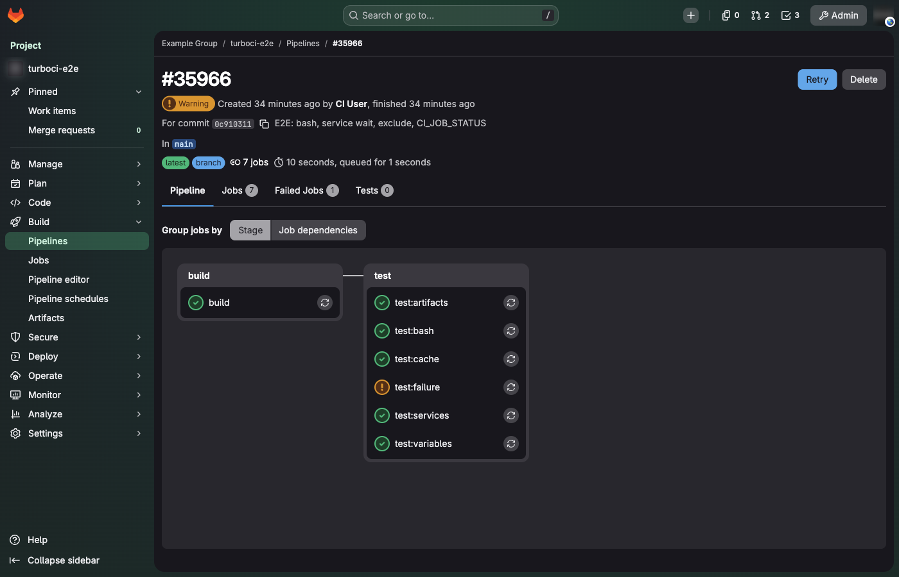
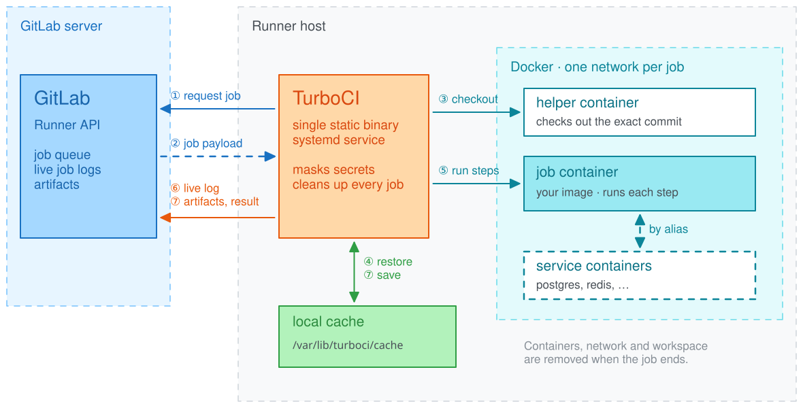
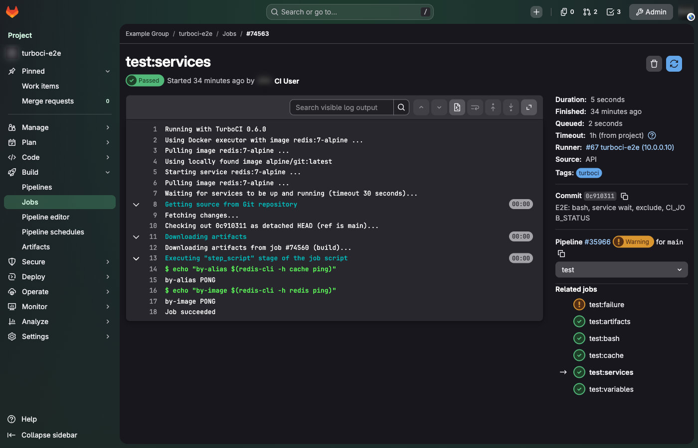

# TurboCI

[](https://github.com/ismoilovdevml/turboci/actions/workflows/ci.yml)
[](https://github.com/ismoilovdevml/turboci/releases)
[](https://ismoilovdevml.github.io/turboci/)
[](LICENSE)

TurboCI is a GitLab CI/CD runner written in Rust. It talks to GitLab's runner API like
[gitlab-runner](https://gitlab.com/gitlab-org/gitlab-runner) does, so your `.gitlab-ci.yml` runs
unchanged: each job runs in its own Docker container, or directly on the host with the shell
executor.

It is one static binary with no external services: no Redis, no database, no helper daemon.



## Why

- **Small:** an 8.4 MB static binary that idles at about 8 MB of memory with 5 threads
  (x86_64 Linux, 16-core host). gitlab-runner used 88 MB idle on the same host.
- **Drop-in:** artifacts, cache, `services`, `needs`, masked variables, cancellation and timeouts
  behave as on gitlab-runner. It can run next to gitlab-runner on the same host and Docker daemon
  without touching its containers.
- **Fast job start:** the checkout, the job image pull and the services start at the same time;
  service ports are probed from the host instead of from an extra container; concurrent jobs share
  one pull of the same image.
- **Fast cache:** caches are solid `tar.zst` archives, extracted while they download from S3 and
  not archived or uploaded again when a job left them unchanged.
- **Protects the host:** it stops taking jobs when memory, disk or load cross a limit, and keeps
  workspaces, caches and unused Docker images within size limits.
- **Corporate networks:** HTTP proxy, a company CA for GitLab and registries, insecure registries
  for `docker:dind`, credential helpers for ECR, GCR and ACR, and a cache shared between hosts
  through S3 (MinIO, Ceph, AWS).
- **Safe by default:** the runner runs as an unprivileged service user with a private `/tmp`,
  secrets are masked in the log, archives are extracted without following symlinks, and image
  allowlists can limit what jobs may run.

## How it works



The runner asks GitLab for a job whenever it has a free slot, and long-polls so a new job is picked
up at once. A small helper container checks out the pipeline's exact commit (job images need no
`git`) while the job image is pulled and the services start. The cache and earlier jobs' artifacts
are restored, the steps run in the job container next to its services, and the log streams to
GitLab with secrets masked. At the end artifacts are uploaded, the cache is saved and every
container and network of the job is removed; the workspace is kept for the project's next job.

## Getting started

Create a runner in GitLab (**Settings → CI/CD → Runners → New project runner**, tag `turboci`),
then install, register and start it with one command:

```bash
curl -sSL https://raw.githubusercontent.com/ismoilovdevml/turboci/main/install.sh \
  | sudo bash -s -- --url https://gitlab.example.com --token glrt-XXXX
```

The installer checks the binary against the release's `SHA256SUMS`, installs Docker if needed,
creates the `turboci` service user and systemd unit, and waits until the runner is online. On
macOS it installs a launchd agent with the shell executor.

Then send a job to the runner's tag:

```yaml
test:
  tags: [turboci]
  image: node:22
  services: [postgres:16]
  script:
    - npm test
```



## Features

| Area | What you get |
|---|---|
| Executors | `docker` (Linux) and `shell` (Linux, macOS); several runners in one process with `[[runners]]` |
| Jobs | `before_script`/`script`/`after_script`, hooks, collapsible sections, timeouts, cancel, `retry`, `image:docker:platform`/`user`, pull policy lists |
| Checkout | clone/fetch/none, shallow, refspecs, submodules, LFS, kept workspaces fetched instead of cloned |
| Artifacts | zip, gzip and raw, `exclude`, `when`, dotenv and JUnit reports, dependency downloads |
| Cache | local and S3, fallback keys, `pull`/`push`/`pull-push`, multipart uploads, unchanged caches skipped |
| Docker | services and aliases, `docker:dind` with TLS, resource limits, `cap_add`/`cap_drop`, `devices`, `gpus`, `sysctls`, `ulimit`, `extra_hosts`, `dns`, `runtime`, allowed images |
| Registries | `DOCKER_AUTH_CONFIG`, `config.json`, credential helpers, a company CA, insecure registries |
| Operations | Prometheus `/metrics`, config reload on `SIGHUP`, admission limits, workspace/cache/image cleanup, graceful drain on `SIGQUIT` |

What is not supported is listed under
[Pipeline support](https://ismoilovdevml.github.io/turboci/pipelines/#not-supported).

## Documentation

The documentation is at **[ismoilovdevml.github.io/turboci](https://ismoilovdevml.github.io/turboci/)**:

- [Installation](https://ismoilovdevml.github.io/turboci/installation/): installer options, manual install, uninstall
- [Connecting to GitLab](https://ismoilovdevml.github.io/turboci/gitlab/): creating the runner and its token
- [Configuration](https://ismoilovdevml.github.io/turboci/configuration/): runners, Docker, shell, proxy, registries, S3 cache, limits
- [Pipeline support](https://ismoilovdevml.github.io/turboci/pipelines/): what works and what does not
- [Operations](https://ismoilovdevml.github.io/turboci/operations/): upgrades, reload, metrics, cleanup, logs, troubleshooting

## Status

TurboCI runs the CI of a team's projects in production on a self-hosted GitLab 19 instance, next
to gitlab-runner on the same host. Release binaries are built for x86_64 and aarch64 Linux, and
macOS on Apple Silicon.

Not supported: Kubernetes, autoscaling, SSH and custom executors, Windows jobs, interactive web
terminals, and external secrets (`secrets:` with Vault and others). GitLab never sends a job that
needs a missing feature to a runner that does not report it.

## Development

You need a stable Rust toolchain; the Docker tests also need a Docker daemon.

```bash
git clone https://github.com/ismoilovdevml/turboci
cd turboci
cargo build --release
cargo test                   # unit tests
cargo test -- --ignored      # Docker and MinIO integration tests
```

| Directory | |
|---|---|
| `src/gitlab` | GitLab runner API client |
| `src/runner_daemon` | job loop, runners, executors, checkout, cache, artifacts, S3, metrics |
| `src/runner_daemon/docker_api` | small Docker Engine API client over the unix socket |
| `src/security` | secret masking |
| `install.sh`, `uninstall.sh` | host installer and uninstaller |
| `e2e/` | end-to-end pipeline run against a real GitLab |
| `docs/` | the documentation site |

## License

MIT, see [LICENSE](LICENSE).
