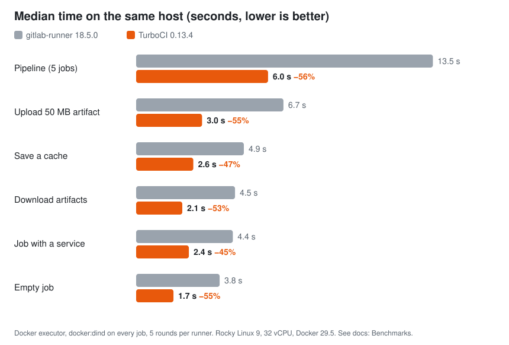

<p align="center">
  
</p>

<h1 align="center">TurboCI</h1>

<p align="center">
  <b>A GitLab CI runner in Rust. Drop-in for gitlab-runner, in one 8.6 MB binary.</b>
</p>

<p align="center">
  <a href="https://github.com/ismoilovdevml/turboci/actions/workflows/ci.yml"></a>
  <a href="https://github.com/ismoilovdevml/turboci/releases"></a>
  <a href="https://turboci.bristleconelab.org/"></a>
  <a href="LICENSE"></a>
</p>

<p align="center">
  <a href="https://turboci.bristleconelab.org/">Documentation</a> ·
  <a href="#getting-started">Getting started</a> ·
  <a href="https://turboci.bristleconelab.org/benchmarks/">Benchmarks</a> ·
  <a href="https://github.com/ismoilovdevml/turboci/releases">Releases</a>
</p>

TurboCI talks to GitLab's runner API like
[gitlab-runner](https://gitlab.com/gitlab-org/gitlab-runner) does, so your `.gitlab-ci.yml`
runs unchanged: each job runs in its own Docker container, or directly on the host with the
shell executor. It is one static binary with no external services: no Redis, no database, no
helper daemon.

|  | TurboCI | gitlab-runner 18.5.0 |
|---|---|---|
| Pipeline of 5 Docker jobs, same host | **7.3 s** | 13.0 s |
| Runner time per shell job, production | **1.1 s** | 4.1 s |
| Binary, Linux x86_64 | **8.6 MB** | 92.0 MB |
| Memory when idle | **~8 MB** | 88 MB |

<picture>
  <source media="(prefers-color-scheme: dark)" srcset="docs/assets/benchmarks/benchmark-dark.svg">
  
</picture>

Measured on one production host (Rocky Linux 9, 32 vCPU, Docker 29.5) with both runners side by
side; the setup, the workload and the production numbers are on the
[Benchmarks](https://turboci.bristleconelab.org/benchmarks/) page.


## Why

- **Fast job start:** the checkout, the image pull, the services and the job container start at
  the same time; the cache and artifacts are restored while the containers start; service ports
  are probed from the host; concurrent jobs share one pull of the same image.
- **Drop-in:** artifacts, cache, `services`, `needs`, masked variables, cancellation and timeouts
  behave as on gitlab-runner. It can run next to gitlab-runner on the same host and Docker daemon
  without touching its containers.
- **Small:** an 8.6 MB static binary that idles at about 8 MB of memory with 5 threads.
- **Fast cache:** caches are solid `tar.zst` archives, extracted while they download from S3 and
  not archived or uploaded again when a job left them unchanged.
- **Protects the host:** it stops taking jobs when memory, disk or load cross a limit, and keeps
  workspaces, caches and unused Docker images within size limits.
- **Corporate networks:** HTTP proxy, a company CA for GitLab and registries, insecure registries
  for `docker:dind`, credential helpers for ECR, GCR and ACR, and a cache shared between hosts
  through S3 (MinIO, Ceph, AWS).
- **Safe by default:** the runner runs as an unprivileged service user with a private `/tmp`,
  secrets are masked in the log, archives are extracted and collected without following symlinks
  out of the workspace, and image allowlists can limit what jobs may run.

## How it works


The runner asks GitLab for a job whenever it has a free slot, and long-polls so a new job is picked
up at once. A small helper container checks out the pipeline's exact commit (job images need no
`git`) while the job image is pulled and the services start. The cache and earlier jobs' artifacts
are restored, the steps run in the job container next to its services, and the log streams to
GitLab with secrets masked. At the end artifacts are uploaded, the cache is saved, the result is
reported and every container and network of the job is removed; the workspace is kept for the
project's next job.

## Getting started

Create a runner in GitLab (**Settings → CI/CD → Runners → New project runner**, tag `turboci`),
then install, register and start it with one command:

```bash
curl -sSL https://raw.githubusercontent.com/ismoilovdevml/turboci/main/install.sh \
  | sudo bash -s -- --url https://gitlab.example.com --token glrt-XXXX
```

The installer checks the binary against the release's `SHA256SUMS`, installs Docker if needed,
creates the `turboci` service user and systemd unit, and waits until the runner is online. On
macOS it installs a launchd agent with the shell executor.

Then send a job to the runner's tag:

```yaml
test:
  tags: [turboci]
  image: node:22
  services: [postgres:16]
  script:
    - npm test
```


To move from gitlab-runner, see [running next to gitlab-runner](https://turboci.bristleconelab.org/gitlab/#running-next-to-gitlab-runner):
both runners can run on the same host while you move projects over one tag at a time.

## Features

| Area | What you get |
|---|---|
| Executors | `docker` (Linux) and `shell` (Linux, macOS); several runners in one process with `[[runners]]` |
| Jobs | `before_script`/`script`/`after_script`, hooks, collapsible sections, timeouts, cancel, `retry`, `image:docker:platform`/`user`, pull policy lists |
| Checkout | clone/fetch/none/empty, shallow, refspecs, submodules, LFS, kept workspaces fetched instead of cloned |
| Artifacts | zip, gzip and raw, `exclude`, `when`, dotenv and JUnit reports, parallel dependency downloads |
| Cache | local and S3, fallback keys, `pull`/`push`/`pull-push`, multipart uploads, unchanged caches skipped |
| Docker | services and aliases, `docker:dind` with TLS, `wait_for_services_timeout`, resource limits, `cap_add`/`cap_drop`, `devices`, `gpus`, `sysctls`, `ulimit`, `extra_hosts`, `dns`, `runtime`, allowed images |
| Registries | `DOCKER_AUTH_CONFIG`, `config.json`, credential helpers, a company CA, insecure registries |
| Operations | Prometheus `/metrics` with per-phase job timings, config reload on `SIGHUP`, admission limits, workspace/cache/image cleanup, graceful drain on `SIGQUIT` |

What is not supported is listed under
[Pipeline support](https://turboci.bristleconelab.org/pipelines/#not-supported).

## Documentation

The documentation is at **[turboci.bristleconelab.org](https://turboci.bristleconelab.org/)**:

- [Installation](https://turboci.bristleconelab.org/installation/): installer options, manual install, uninstall
- [Connecting to GitLab](https://turboci.bristleconelab.org/gitlab/): creating the runner and its token
- [Configuration](https://turboci.bristleconelab.org/configuration/): runners, Docker, shell, proxy, registries, S3 cache, limits
- [Pipeline support](https://turboci.bristleconelab.org/pipelines/): what works and what does not
- [Operations](https://turboci.bristleconelab.org/operations/): upgrades, reload, metrics, cleanup, logs, troubleshooting
- [Benchmarks](https://turboci.bristleconelab.org/benchmarks/): how it compares with gitlab-runner, and how to measure your own runners

## Status

TurboCI runs a team's CI in production on a self-hosted GitLab 19 instance, Docker and shell
jobs, next to gitlab-runner on the same host. Release binaries are built for x86_64 and aarch64
Linux, and macOS on Apple Silicon.

Not supported: Kubernetes, autoscaling, SSH and custom executors, Windows jobs, interactive web
terminals, and external secrets (`secrets:` with Vault and others). GitLab never sends a job that
needs a missing feature to a runner that does not report it.

Bugs and ideas are welcome in [issues](https://github.com/ismoilovdevml/turboci/issues).

## Development

You need a stable Rust toolchain; the Docker tests also need a Docker daemon.

```bash
git clone https://github.com/ismoilovdevml/turboci
cd turboci
cargo build --release
cargo test                   # unit tests
cargo test -- --ignored      # Docker and MinIO integration tests
```

| Directory | |
|---|---|
| `src/gitlab` | GitLab runner API client |
| `src/runner_daemon` | job loop, runners, executors, checkout, cache, artifacts, S3, metrics |
| `src/runner_daemon/docker_api` | small Docker Engine API client over the unix socket |
| `src/security` | secret masking |
| `install.sh`, `uninstall.sh` | host installer and uninstaller |
| `e2e/` | end-to-end pipeline run against a real GitLab |
| `docs/` | the documentation site |

## License

MIT, see [LICENSE](LICENSE).
